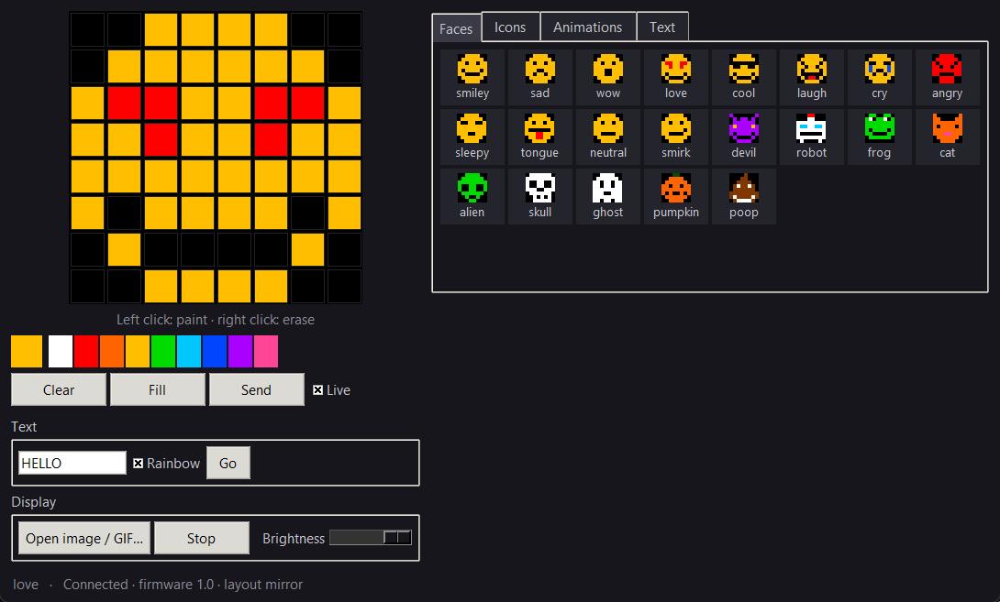
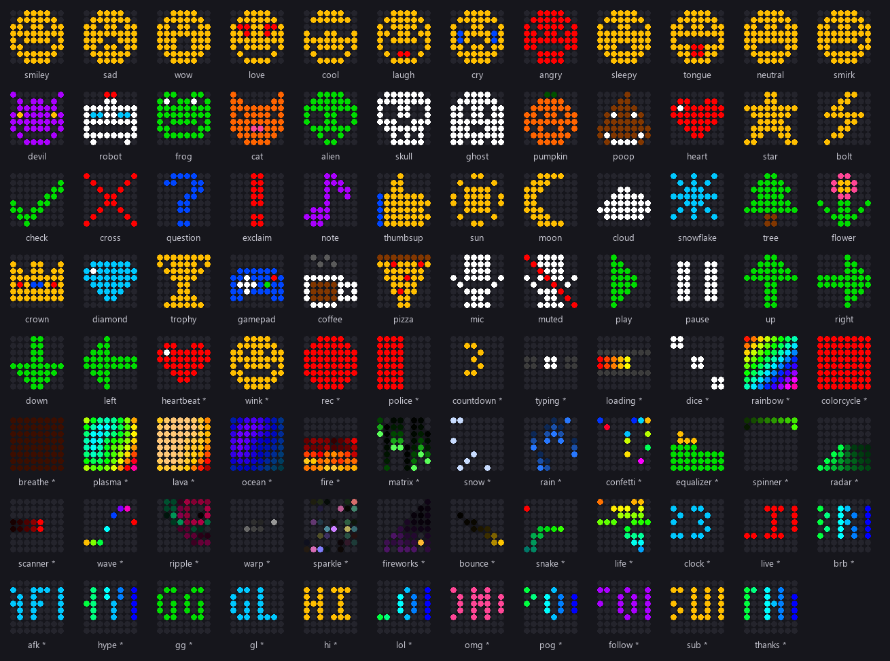

# OpenEmote

I wanted to put a smiley on my Razer Seiren Emote. Turns out you need Razer's Stream Controller app
for that, and while it's open it takes over the rest of my Razer RGB stuff. So I figured out how the
display talks over USB and wrote this instead.



## What it does

- Draw on the display live
- 112 presets (faces, icons, animations, stream text), almost all animated
- Playlists: right-click presets to add them, and the display cycles through them
- Runs in the system tray when you close the window, so the display keeps going
- Scrolling text
- Images and GIFs, scaled to 8×8
- Command line, so you can trigger it from scripts or a Stream Deck



## Install

Python 3.9+.

```sh
git clone https://github.com/VssBence/OpenEmote.git
cd OpenEmote
pip install .[images]
```

Or grab `OpenEmote.exe` from Releases. To build it yourself: `pip install pyinstaller pillow`, then
`python tools/build_exe.py`.

## Usage

`openemote` opens the app. Or from the command line:

```sh
openemote list
openemote show smiley
openemote show smiley --still        # one frame, stays after exit
openemote show fire --duration 10
openemote cycle smiley love beer fire --seconds 5
openemote text "LIVE NOW" --color red
openemote image cat.gif
openemote color ff00ff
openemote off
openemote --brightness 30 show heart
```

From Python:

```python
from openemote import EmoteDisplay, hsv

with EmoteDisplay() as display:
    display.show([hsv(i / 64) for i in range(64)])  # 64 (r, g, b) tuples, row by row
```

## Adding presets

Presets are in [`openemote/presets.py`](openemote/presets.py). Draw it in ASCII and pick an animation:

```python
add("ghost", "Floating ghost", "faces", bob(sprite([
    "..WWWW..",
    ".WWWWWW.",
    "WWKWWKWW",
    "WWKWWKWW",
    "WWWWWWWW",
    "WWWKKWWW",
    "WWWWWWWW",
    "WW.WW.WW",
])))
```

There are helpers for `blink`, `bob`, `shake`, `shine`, `pulse`, `flash`, `slide` and `draw_in`.

PRs welcome.

## How it works

Inside the mic there's a USB hub with two devices: the audio part and a separate display controller
(`1532:0F1B`). The display uses the same HID protocol as Razer keyboards. Notes are in
[docs/PROTOCOL.md](docs/PROTOCOL.md).

## Problems

- **Picture looks scrambled:** run `openemote calibrate`, try `--layout split-snake`, and open an issue.
- **Display goes back to Razer's emote:** close Stream Controller.
- **Linux/macOS:** not tested.

Not affiliated with Razer. MIT license.
